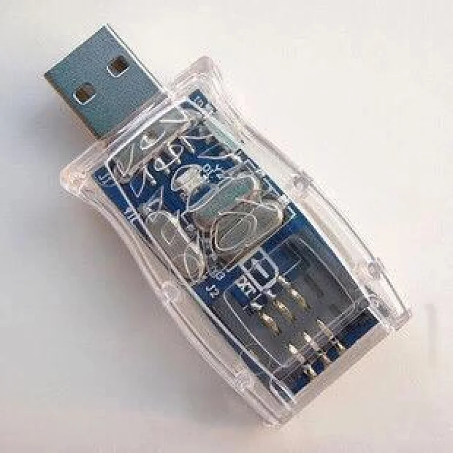
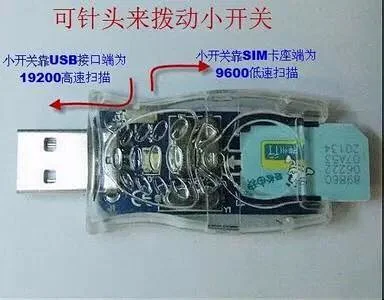

# Serial (Phoenix) card reader

A transparent USB-A reader with a USB-serial bridge inside — **not** a CCID
device. Windows exposes it as a `COMx` port, and the app drives it directly:
it speaks raw T=0 on the wire and toggles the card's reset line through RTS.

It reads a card the same way a CCID reader does (ATR, ISD-R, ES10), and it can
download a profile, but every APDU costs about 100 ms, so it is roughly an
order of magnitude slower than PC/SC.

## Before you plug it in

**Check the baud switch.** It sits inside the transparent shell and is easy to
miss; a needle is enough to move it.

| Switch position | Speed | Use |
|---|---|---|
| Towards the USB plug | 19200 | **Use this one.** |
| Towards the SIM slot | 9600 | Legacy; the app expects 19200 |

The reader's own clock is fixed, so 19200 is the only rate that produces a
readable ATR.

## Connecting

1. Insert the card, contacts facing the reader's contact pins, notch in the
   usual corner. A card that is not fully seated still powers up but never
   answers — the symptom is "no ATR".
2. Plug the reader in and find the port in **Device Manager → Ports (COM & LPT)**.
   If it shows up as an unknown device, install the PL2303 driver.
3. In the app: **Settings → Reader types → Phoenix serial reader** (on), then go
   back to the profile list. The reader appears as `COMx`; tap it.

The reader is listed even while another program holds the port open, but
connecting will then fail with "cannot open COM4" — close that program first.

## What has been verified on this hardware

Measured on a test eUICC with the app's serial adapter:

| Step | Result |
|---|---|
| ATR | returned, 23 bytes (T=0) |
| SELECT ISD-R | `9000`, 33-byte FCI |
| GetEID / Info2 / Configured addresses | `9000` |
| AuthenticateServer (830 B, 6 blocks) | `authenticateResponseOk`, ~2.7 s |
| PrepareDownload (717 B) | `downloadResponseOk`, ~1.9 s |
| GetBoundProfilePackage | 11.6 KB |
| LoadBoundProfilePackage | 17 segments, all `9000`, ~13 s |

A 11.6 KB profile therefore takes about 20 seconds end to end. A production
profile of 300 KB would take roughly ten minutes, and any block that fails
restarts the download.

## Known limitations

- **There is no software power cycle.** The reader powers the card from its own
  regulator, so neither RTS nor closing the port cuts VCC. If a card goes
  silent — after a malformed APDU, or an aborted chunked write — unplug the
  reader and plug it back in. Nothing else recovers it.
- **One logical channel.** Reusing a channel number that has been closed makes
  the card answer `6881`; the app now probes the channel before reuse.
- **`61 xx` responses must be drained.** `61 00` means 256 bytes are waiting,
  not zero. Ignoring it silently drops the whole answer of a chunked STORE DATA.
- **Some cards refuse `refreshFlag=TRUE`** on EnableProfile and return a
  vendor-specific error (seen: `7`). The app retries with `refreshFlag=FALSE`,
  which succeeds there.

## Troubleshooting

| Symptom | Meaning | Fix |
|---|---|---|
| No ATR | card not seated, or switch at 9600 | reseat, move the switch, replug |
| ATR ok, every APDU silent | card wedged by an earlier bad APDU | unplug and replug the reader |
| `6D00` on MANAGE CHANNEL | card does not implement it | harmless; the app falls back to channel 0 |
| `6881` | channel number no longer valid | reopen a session |
| `6A80` on AuthenticateServer | request built wrong | check that ES9+ fields are not double-wrapped in a TLV |
| `61 00` | 256 bytes pending | GET RESPONSE with Le=0 |
| Download stalls at a segment | link noise | replug, retry the download |

## When to use a CCID reader instead

Use PC/SC when you can. A CCID reader needs no switch, no driver, handles the
power cycle itself, transfers a profile in seconds instead of minutes, and
cannot wedge a card through a framing mistake. The serial path exists for
readers that have no CCID firmware, not because it is better.
